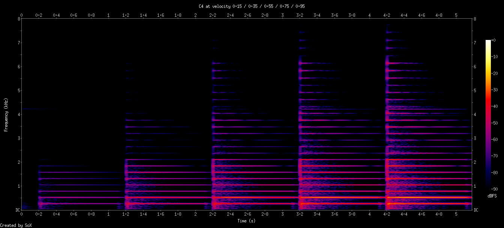
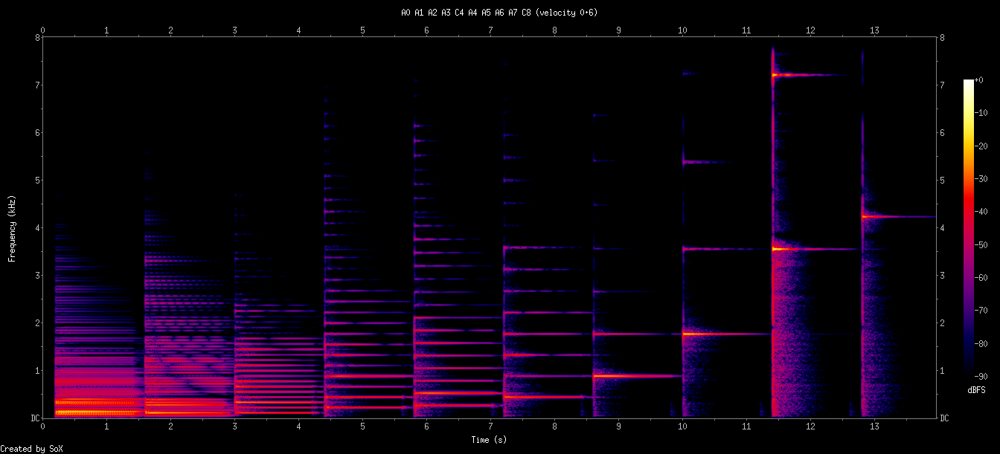

# 物理モデリングピアノ音源 作業レポート

作成日: 2026-11-15 / 改訂: 2026-11-20（軽量化「0.12 改訂 9」）、2026-11-19（v2 の華やかさの引き継ぎ「0.11 改訂 8」、中低音域の輝き「0.10 改訂 7」）、2026-11-16（音色の作り直し「0.5 改訂 2」、音量補正と低音強調「0.6 改訂 3」、録音との照合「0.7 改訂 4」）

## 0. 要約

| 作業 | 結果 |
|---|---|
| 1. 物理モデリング音源 | 88 鍵すべてを「ハンマー（非線形フェルト）→ 弦（デジタルウェーブガイド、1 鍵あたり 2〜3 本を駒で結合）→ 駒 → 響板（グランドピアノ形の板の固有モード）→ 空気への放射（マイク 2 本）→ 部屋」でリアルタイム計算する音源を Rust で実装した。サンプル（録音）は一切使っていない。改訂 2 で弦と響板を双方向に結合し直した。 |
| 2. Web アプリ | Rust を WebAssembly にビルドし AudioWorklet 上で動かす Web アプリを作成した。PC キーボード・マウス/タッチ・MIDI で演奏できる。ボイス数の上限・ボイススティールはなく、88 鍵すべて（240 本の弦モデル）が同時に鳴る。 |
| 3. レイテンシー | ブラウザ上で実測し、キーイベントからスピーカー出力まで中央値 **約 23 ms**（うち約 22〜23 ms は出力デバイス側で、アプリが制御できる区間は 1〜3 ms）。改善として、出力取り出し位置の変更（低音で最大 約 6 ms 短縮）、`latencyHint` の最小化（`playback` 比 −31 ms）、JIT ウォームアップ（初回打鍵の 15 ms のストールを解消）、起動時アンダーランの解消、和音打鍵時の計算ピーク削減を実施した。 |
| 4. レポート | 本書と `docs/experiments/` の計測ログ。 |

**重要な注意（検証の限界）**: 作業者（AI）は音を聴くことができないため、音色の検証はすべて客観指標（部分音の周波数・減衰率・打鍵時間・スペクトル・スペクトログラム）と文献値との比較で行った。「ピアノをマイクで収録したような音」に聴こえるかどうかの最終判断は、実際に聴いて確認していただく必要がある。パラメータは文献値と物理的整合性に基づいており、耳による追い込み（ボイシング）は行っていない。

## 0.5 改訂 2（2026-11-16）: 音色の作り直し

初版は「安っぽいシンセサイザーのような音」という評価だった。計測し直して原因を特定し、弦より先（駒・響板・放射・部屋）をほぼ全面的に作り直した。**PCM 録音は一切使っていない**（響板のテーブル `engine/data/board.bin` も板の方程式を解いた計算結果で、測定値・録音ではない）。

### 初版の何が人工的だったか

| 原因（計測で確認） | 対策 |
|---|---|
| うなりの谷が倍音を順に掃引していた。同じ鍵の弦のずれが全倍音で一定比なので、谷の時刻が倍音番号に反比例して並び、フェイザーのように聴こえる（初版 A1 のスペクトログラムに斜めの暗い帯）。 | 弦と響板の結合を周波数依存にし（下記）、弦ごとにインハーモニシティを 1〜4 % ずらした。部分音ごとにうなりの速さ・深さが不規則になる。 |
| 全部分音が滑らかな指数減衰。駒を「定数の抵抗」で表していたため。 | 駒の動きを響板のモードそのもので決める双方向結合に変更。部分音ごとに減衰率が違い（C4 で −5〜−39 dB/s）、二段減衰の折れ方もばらつく。 |
| 出力の約半分が弦の波形そのもの（「直接音」経路）で、胴鳴りがない。 | 直接音経路を廃止。音はすべて響板モードの放射として出る。 |
| 響板が長方形の板で、偶数次モードが放射しないため 1/3 オクターブ幅の「穴」が −15〜−20 dB あった（C4 の基音が −20 dB）。 | グランドピアノ形の輪郭・斜めの木目・駒を持つ板の固有モードを Rayleigh–Ritz 法で計算（`gen_board`）。帯域レベルの凹凸は 100 Hz〜6 kHz で概ね ±5 dB。 |
| ハンマーが軽すぎた。文献値（1 弦あたりの質量）を 3 本弦で共有していたので実質 1/3。接触時間が短く（C4 で 1.3 ms）細い音。 | ハンマーヘッド全体の質量（9 g 前後）を弦で分け合う形に修正。接触時間 C4 1.9〜3.0 ms、C2 3.3〜5.2 ms（文献の実測に近い）。 |
| 打鍵の機械音、部屋の響き、弦の縦振動、非ダンパー弦の共鳴がない。 | すべて物理モデルとして追加（下記）。 |

### 新しい信号の流れ

```
鍵 ─▶ ハンマー ⇄ 弦 1..3 ⇄ 駒 ⇄ 響板のモード 465 個 ─▶ マイク L/R（近接）────────────▶ 出力
 │                └ 縦振動（張力変化）─▶ 駒         └▶ 4 方向の遠方放射 ─▶ 部屋 ─▶ 出力に加算
 └▶ 鍵床への衝撃 ─────────────────▶ 響板
```

* **弦と響板の双方向結合**（`engine.rs`, `soundboard.rs`）。各サンプルで、弦から駒に来る波 `a`、駒の速度 `v`、響板のアドミタンス（瞬時成分 `Y` と履歴 `h`）について `F = 2S − K v`, `v = h + Y F` を連立して解く（駒 6 点の 6×6、逆行列は発音中の弦が変わったときだけ更新）。響板の各モードは複素 1 極共振器で、駆動点アドミタンスが正実（受動）になる離散化 `(1 + p z⁻¹)/(1 − p z⁻¹)` を使っているので、モードの組がどうであれ結合系は発散しない。減衰・二段減衰・うなり・共鳴はすべてこの結合から出てくる（初版の経験的な共鳴フィードバックは廃止）。
* **鍵ごとのてこ比**。駒は裸の板より硬いので、各鍵の弦は板にてこ比 c（0.5〜0.9）で結合する。c は「ユニゾン同相モードの平均減衰率が鍵の目標値になる」よう響板の平均コンダクタンスから決める。基音が響板の共振に重なる鍵（すぐ音が死ぬ鍵）は c を下げる。結合の虚部で生じるピッチのずれ（最大数セント）は調律側で 7 割を打ち消す。実測の基音誤差は全鍵 0.5 セント以内。
* **響板**（`src/bin/gen_board.rs` → `data/board.bin`）。1.42 m × 1.55 m の矩形内に約 1.9 m グランドの輪郭を取り、輪郭の外は硬い基礎で固定（＝リムでクランプ）。スプルース + 響棒を均質化した直交異方性板（木目は長駒と平行、−47°）、長駒と低音駒を梁（曲げ剛性 + 質量）として加え、sin×sin 基底 約 1200 個で一般化固有値問題を解く。最低モード 54 Hz、モード密度 0.04〜0.07 個/Hz、10 kHz まで 465 個（5 kHz 以上は重なりが大きいので半分に間引き、駆動点モビリティを 2 倍にして補償）。
* **放射**。各モードについて、板全面の Rayleigh 積分を受音点ごとに計算し、モードごとの複素重み（振幅と位相）にしてある。受音点は開いた屋根の下の近接マイク 2 本（低音弦側・高音側、板から 45 cm。これが L/R）と、部屋に向かう遠方 4 方向。屋根の反射は鏡像として含む。共通の伝搬遅延は除いてあるのでレイテンシーは増えない。板は無限バッフルではないので 100 Hz 以下を 1 次で落としている。
* **部屋**（`room.rs`）。9.6 × 7.1 × 3.9 m の部屋の鏡像法による初期反射（2 次まで、各反射は対応する方向のピアノの放射を使う）と、8 本のフィードバック遅延ネットワークによる残響（T60 1.25 s、高域 0.7 s）。直接音はこのモジュールを通らない。量は設定で変えられる（既定 45 %。改訂 7 で 30 % に変更。直接音に対して鍵により −7〜−13 dB）。
* **打鍵・離鍵の機械音**。鍵が鍵床に当たる衝撃を 3 ms の力パルスとして響板の低次モードに加える（離鍵時は弱い逆向きのパルス）。音のピークに対して −20〜−30 dB。高音域では 400 Hz 以下の成分がこれで決まる（実機の高音の「コツッ」という音）。
* **弦の縦振動**。弦の傾きの 2 乗の積分（張力変化）を弦上の約 100 点で求め、準静的な成分（ファントムパーシャル）と縦 1 次モードの共振を駒の力に加える。低音 ff で各帯域 −30〜−40 dB 程度。振幅の 2 乗に比例するので弱打ではほぼ消える。
* **非ダンパー弦**。最高域 19 鍵（ダンパーなし）は常に響板と一緒に動き、他の音に共鳴する。押さえたままの鍵の弦も共鳴する。
* **整調**。（改訂 3 でラウドネス計測に基づく補正テーブルに置き換えた。0.6 節参照。）

### 確認できたこと・できていないこと

* 確認済み（`docs/experiments/02`, `03`, `07`）: ピッチ・インハーモニシティ、部分音ごとの減衰のばらつき、打鍵時間、ダンパー（離鍵後 T60 0.15〜0.5 s）、全 88 鍵 fff + ペダルでの安定性（44.1/48/96 kHz で単調減衰）、長時間平均スペクトル（ピーク 600〜1000 Hz、1→4 kHz で約 −12 dB/oct）、ブラウザ 96 kHz でアンダーラン 0 回、レイテンシー中央値 23.4 ms（初版と同じ。アルゴリズム上の遅延は 0〜0.08 ms）。
* **未確認**: 作業者は音を聴けないので、「本物と区別がつかない」かどうかは確認できていない。客観指標は実機の文献値に近づけたが、明るさ（ハンマーの硬さ）、打鍵ノイズ・縦振動・部屋の量は聴感での追い込みが必要な可能性が高く、すべて設定スライダーで変えられるようにしてある。特に C4 付近の ff では縦 1 次モード（約 4 kHz）が 3〜8 kHz 帯で弦の部分音に対し −8 dB と強めに出ており、耳障りなら「弦の縦振動」を下げてほしい。
* CPU 負荷は増えた（WASM 48 kHz: 1 音 6 %、10 音 + ペダル全弦共鳴 21 %、全 88 鍵 26 %。96 kHz ではその約 2 倍で、全 88 鍵同時打鍵の最長ブロックが 1.3 ms と予算 1.33 ms ぎりぎり）。遅いマシンではサンプルレート 48 kHz を選ぶとよい。
* 以下の 3.3・3.5・3.6・4.3・4.4・6.2 の一部は初版の記述で、上記と食い違う箇所は本節が正しい（「低レイテンシー出力」の切り替えは廃止し、常に遅延なし）。

## 0.6 改訂 3（2026-11-16）: 鍵ごとの音量補正と低音強調

### 鍵ごとの音量のばらつき

「鍵盤ごとに音量が不揃い」という指摘を計測で確認した。意図的なランダム化（ヒューマナイズ）は入っていない。原因はモデルの物理で、響板からマイクへの伝達特性と、ハンマーが弦を励振する効率が鍵ごとに違うためである。補正なしでは、同じ強さで弾いたときのラウドネスが C4 に対して −21〜+10 phon ばらついていた（10 phon で体感ほぼ 2 倍）。改訂 2 で入れた簡易な「整調」は見積もりが粗く、これを取り除いて次の仕組みに置き換えた。

* **補正テーブル**（`engine/data/leveling.bin`、`src/leveling.rs`）。打鍵の強さ（0〜1）からハンマー速度を決める直前に、鍵 × 強さ 9 段階の倍率表を通す。物理モデルには手を入れておらず、表を通るのは入力だけ。設定「音量補正」でオン/オフできる（既定オン）。オフにすると全鍵が同じハンマー速度で打たれる（物理モデルそのまま）。
* **基準とラウドネスの計算**（`src/loudness.rs`）。基準は同じ強さで弾いた C4。各音の最も大きい約 0.2 秒について、1/3 オクターブ帯域レベルを ISO 226:2003 の等ラウドネス曲線で phon に直し、sone に変換して Stevens の方法（ISO 532 A）で合算する。フルスケール = 100 dB SPL と仮定（mf の単音が約 70 dB）。表は `gen_leveling` がモデルを実際に鳴らして各鍵の倍率を解いて作る（44.1/48/88.2/96 kHz 別）。**モデルや響板を変えたら作り直す必要がある。**
* **結果**（`docs/experiments/08-leveling-bass.md`）。強さ 0.3〜0.6 では全 88 鍵が C4 の ±1 phon 以内（標準偏差 0.05〜0.12 phon）。
* **限界**。(1) A7 は励振効率が特に低く、強さ 0.75 以上では補正しきれない（96 kHz で 0.75: −1.7、0.9: −4.5、1.0: −6.1 phon。48 kHz ではそれぞれ −3.4 / −6.3 / −7.9）。ハンマー速度の上限 16 m/s に達するため。(2) 強さ 0.1 以下のごく弱い打鍵では高音域 11 鍵が ±1 phon を外れる（可聴限界に近く、打鍵ノイズが支配的になるため）。(3) ラウドネスは単音を 1 つずつ鳴らした場合の値で、再生音量が仮定と大きく違うと等ラウドネス曲線の形が変わり、低音・高音の釣り合いが少しずれる。

### 低音の強調

小さいスピーカー向けに低音域を持ち上げる出力段（`src/post.rs` の `BassBoost`）を追加した。エンジン本体（`engine.rs`）には含めておらず、`wasm.rs` の 2 か所の呼び出しとファイルを消せば元に戻る。量 0 では信号に一切触れない。

* ローシェルフ（量 1 で 50〜120 Hz を約 +9 dB、180 Hz で +8 dB、中高域比）と 35 Hz のハイパス（小型スピーカーが出せない帯域に余裕を使わないため）、およびヘッドルームを戻すレベル補正（量 1 で −3.5 dB）。ここまでは線形のフィルタで歪みは生じない。
* 先読みなしのピークリミッタ（レイテンシー増なし）。通常の演奏（6 音の和音、強さ 0.6）では一度も動作せず、出力は線形フィルタの結果と一致する。fff の低音和音や全 88 鍵同時打鍵でだけ音量を最大 5〜8 dB 下げ、1.0 以上のサンプルは 0 個。

### あわせて直した不具合

* 起動直後（および全消音の直後）の最初の 1 音だけ約 8 dB 大きく、ポップノイズが乗っていた（96 kHz で顕著）。全消音時に出力段のハイパスの状態が残っていたため。
* 全 88 鍵を同一瞬間に fff で打つ極端な場合、96 kHz では最長ブロックが 1.34〜1.37 ms と予算 1.33 ms をわずかに超える（音量補正で高音のハンマー速度が上がったため）。通常の演奏では起きない。

## 0.7 改訂 4（2026-11-16）: 録音との照合によるコアの調整

`midi/music2.mid`（`music1.mid` と同一内容）と `wave/music2.wav` を突き合わせ、同じ MIDI をエンジンでレンダリングした音と同じ指標で比較しながら、物理モデルのパラメータと響板を直した。計測ログは `docs/experiments/09-reference-comparison.md`。出力段の低音強調（`post.rs`）には手を入れていない。音量補正テーブルは仕組みを変えず、モデルに合わせて作り直した。

### 参照音源について分かったこと

* `music2.wav` は MIDI と開始 0.34 秒・テンポ比 1.000 で一致する。`music1.mid` は `music2.mid` とバイト単位で同一で、`music1.wav`（262.5 秒）とは対応しない。`music1.wav` は楽譜に依らない比較（長時間平均スペクトル）にだけ使った。2 つの録音のスペクトルはほぼ同じで、同じ楽器・同じ収録系と見てよい。
* 隣り合う鍵（69〜72、77〜79、80〜82、45〜46 など）の部分音レベルが 0.1〜0.3 dB の精度で一致し、冒頭の無音は −99 dBFS、全音符がベロシティ 80 である。1 つの収録を数鍵に引き伸ばすサンプリング音源（電子ピアノやソフト音源）を経由した音である可能性が高い。元は実ピアノの収録と考えられるので音色の目標としては使えるが、鍵ごとの細かな癖や 5 kHz 以上の急な落ち込み（音源側のフィルタの疑い）は追わず、音域ごとの傾向を合わせた。

### 初めの状態との差と対策

| 録音との差（計測） | 対策 |
|---|---|
| 73〜131 Hz の基音が第 2 部分音に対して約 12 dB 弱い。80〜100 Hz 帯が 9〜11 dB 不足。 | 響板を直した（`gen_board`）。(1) クラウンと弦の下向きの力による剛性を弾性床として加え、最低次モードを 54 Hz → 75 Hz に上げて 75〜160 Hz にモードを密に並べた。(2) 縁に向かって薄くなる板と響棒の先細りを、低次モードのモード質量を下げる形で近似した。(3) 近接マイクには遠方用の 100 Hz の低域減衰を掛けない（近接場では板の表裏の打ち消しが小さい。55 Hz のみ）。 |
| 基音が響板の共振に重なる鍵の結合を弱める補正が、低音の「強く鳴って速く減衰する」基音を消していた。 | 補正を廃止し、代わりに駒によるピッチの引き込みが 3 セント、基音の減衰率が公称の 1.3 倍を超える鍵だけ結合を抑える。引き込みは反射係数の位相から求めて調律で 75 % 打ち消す。基音の誤差は 3 鍵おきの実測で 1.6 セント以内（改訂 3 までは 0.5 セント以内）。 |
| 伸ばした音の減衰が録音の約半分の速さ（C4 付近の基音で 10 dB/s に対し 25 dB/s 前後）。 | 弦と響板の結合を決める公称減衰率を、中音域で約 2 倍に上げた（C4 9 → 19、C5 15 → 25、C6 25 → 40 dB/s）。 |
| 1 kHz 以上が 5〜8 dB、打鍵直後の 4〜16 kHz が 10 dB 以上強い。低音の第 10〜30 部分音が 6〜10 dB 強い。 | ハンマーフェルトの剛性を全域で下げた（A0〜C2 で 0.16 倍、C4 で 0.2 倍、C5・C6 で約 0.23 倍、C7 で 0.3 倍）。響板の内部摩擦を周波数とともに増やした（低中域 2.2 %、5 kHz で約 6 %）。 |
| 離鍵後の音量の落ち方が急（30〜115 ms 後で録音 −6 dB に対し −12 dB）。残響の尾が長い。 | ダンパーの消音時間を 1.7 倍に、部屋の残響時間を 1.25 → 1.0 s（高域 0.7 → 0.6 s）にした。 |
| 低音が左右逆相に放射されていた（62〜79 Hz で side が mid より 5 dB 大きい）。 | 近接マイクの間隔を 0.77 m → 0.36 m にし、右マイクを 2 番目のモードの節線付近に置いた。 |
| 調律とインハーモニシティが録音と違う（低音の B が 1.5 倍、高音が 0.8 倍。低音が 4〜5 セント高く、高音が 2〜3 セント低い）。 | B の式とストレッチ曲線を実測値に合わせた（C2 1.0e-4、C4 2.6e-4、A5 1.6e-3）。 |
| 駒の局所損失が高音域で弦のエネルギーの約半分を放射せずに捨てていた。 | 局所コンダクタンスを 1.5e-4 → 0.6e-4 s/kg に下げ、高音域の公称減衰率も録音に合わせて上げた。 |

### 結果（`music2` を両方で鳴らした比較）

| 指標 | 録音 | 改訂前 | 改訂後 |
|---|---|---|---|
| 1/3 オクターブ長時間平均スペクトルの録音との差（79 Hz〜5 kHz の各帯域） | — | −7〜+8 dB | −5〜+4 dB |
| 同、80 Hz・100 Hz 帯 | — | −6、−7 dB | 0、−2 dB |
| 同、6.3 kHz 帯 | — | +14 dB | +12 dB |
| 打鍵 4 ms 後の 4〜8 kHz のレベル | −37.6 dB | −27.3 dB | −30.4 dB |
| 打鍵 4 ms 後の 8〜16 kHz のレベル | −61.3 dB | −48.5 dB | −54.9 dB |
| 打鍵 30 ms 後の 60〜125 Hz のレベル | −8.1 dB | −14.2 dB | −7.7 dB |
| 伸ばした和音の 0.7 秒間の減衰 | 12.6 dB | 5.3 dB | 13.7 dB |
| 低音（鍵 31〜48）の基音レベルの録音との差 | — | −6〜−8 dB | −1 dB |

### 残っている差・注意

* 中高音域（鍵 61〜84）の第 10 部分音より上は、逆に録音より 5〜20 dB 弱く出ている（録音側でも基音より 45〜75 dB 低い成分）。打鍵直後の高域バーストとの兼ね合いで、ここは詰め切れていない。
* 5 kHz 以上は録音より 3〜12 dB 多い。録音側が音源のフィルタで落ちている疑いがあり、これ以上は合わせていない。明るすぎる場合は「ハンマーの硬さ」を下げるとよい。
* 最高域（A6 より上）は同じハンマー速度での音量が中音域より小さく、音量補正が 4〜7 dB（A7 は 17 dB）強く叩かせる。そのぶん最高域の打鍵音は明るい。A7 が補正しきれないのは改訂 3 と同じ。
* 音量補正の基準を C4 単独から F3〜G4 の中央値に変えた（C4 が響板の谷に当たると全体が弱打側に寄るため）。ごく弱い打鍵（強さ 0.06）の高音域は可聴限界に近く補正の解が定まらないので、解けなかったセル（1 サンプルレートあたり 18〜25 個）は一段強い打鍵の補正値を引き継ぐ。
* 響板モードは 465 個のまま。CPU 負荷は WASM 48 kHz で 1 音 6.5 %、10 音 + ペダル全弦共鳴 22 %、全 88 鍵 28 %（改訂 3 とほぼ同じ）。96 kHz の全 88 鍵同時打鍵の最長ブロックは 1.38 ms で、予算 1.33 ms をわずかに超える点も改訂 3 と同じ。
* 打鍵ノイズの力を 1.2 → 0.8 N·s/m にした（響板の低次モードが動きやすくなったぶんを戻した）。
* ブラウザ（Chromium、44.1 kHz）で起動・発音・アンダーラン 0 回を確認した。
* 同じ曲のレンダリング結果を `docs/music2-engine.wav` に置いた（`wave/music2.wav` と聴き比べ用。`*.wav` は Git 管理外）。
* 既定の出力ゲインを 0.016 → 0.013 にした（モデルの出力が約 2 dB 上がったため）。
* 作業者は音を聴けないので、ここでの一致はすべて計測値の上の話である。

## 0.8 改訂 5（2026-11-17）: ペダルを踏んだままの同音連打

ダンパーペダルを踏んだまま同じ鍵を 125〜250 ms 間隔で連打すると、鍵によってはその鍵の音程と違う響きが目立つ、という指摘を全 88 鍵で検査した（`engine/src/bin/repeat.rs`、結果は `docs/experiments/10-pedal-repetition.md`）。

* **原因**。再打鍵の処理ではなく、ペダルで開放された「打鍵していない弦」の共鳴。(1) 響板の共振と同じ高さに調律された弦（136〜156 Hz、195 Hz、394 Hz、697 Hz、1166 Hz、1389 Hz 付近）が、どの鍵を弾いても打鍵のたびに駆動され、数秒残るので連打で積み上がる。低音駒の端では 140 Hz のモードが特に動きやすく（駒コンダクタンス 0.021 s/kg）、モードに入ったエネルギーの大半が弦に移っていた。(2) 同じ駒領域の弦は 2 つの駒点を共有しているため、隣の鍵の弦が半音違いの高さで鳴る（C#4 の連打で C4 が −15 dB）。現象自体は実物にもあるが、強さがモデルの単純化で誇張されていた。
* **対策**。(1) 1 つの響板モードが駒点に見せるコンダクタンスに上限 4e-3 s/kg を設けた（`soundboard.rs` `G_CAP`。対象は 465 モード中 10 個、140 Hz が ×0.44）。(2) 打鍵されていない弦と駒の結合を 0.35 倍にした（`engine.rs` `SYMPATHETIC_LEVER`。打鍵で 1 に戻り、離鍵後に自分の音が 40 dB 減衰すると徐々に 0.35 へ戻る）。音量補正テーブルは作り直した。
* **結果**。「その鍵の成分以外」のパワー（A 特性、その鍵の成分に対する比、3 つの打鍵間隔の最悪値）は、鍵 21〜89 の音域別平均で −22〜−25 dB から −29〜−32 dB に、最悪の鍵で −7.4 dB から −19.9 dB になった。ピッチは ±0.8 セント以内のまま、全 88 鍵 + ペダルの安定性、CPU 負荷も変わらない。ペダルの共鳴は弱くなったが残っている（離鍵後の残響がペダルなしより 10 dB 大きい）。
* **残っているもの**。最高音域（鍵 90 以上）の値は大きいままだが、これは音そのものが 0.2 秒でほぼ消えるためで、残るのは打鍵で響板が鳴る低い音（ペダルなしの単音にも同じ強さで含まれる）。連打のタイミングで自分自身の部分音の釣り合いが変わるのは物理どおりの挙動で、手を加えていない。耳での確認はしていない（計測のみ）。

## 0.9 改訂 6（2026-11-18）: 基準鍵盤の音色を他の鍵盤へ補間

耳で「本物と比べて見劣りしない」と判定された 40 鍵（D1、G1、B1、C2〜C4 の全鍵、D4、E4、F4、G4、C5、D5、E5、F5、C6、A6、D7、G7。以下「基準鍵盤」）の音色をもとに、残り 48 鍵の音色を作り直した（`engine/src/morph.rs`、`engine/src/bin/gen_morph.rs`、記録は `docs/experiments/11-morph.md`）。

* **なぜ「パラメータの補間」では済まないか**。`design.rs` の鍵ごとの物理パラメータ（弦長・張力・ハンマー・減衰率など）は、もともと鍵番号に対して滑らかな補間で与えてある。隣り合う鍵の音色が違うのは、各部分音が響板の共振のどこに当たるかでマイクへの届き方が鍵ごとに 10 dB 以上変わるためで、これは入力パラメータではなくモデルの結果である。そこで補間するのは結果のほう、つまり「各部分音が左右のマイクにどのレベルで届くか」にした。
* **方法**。基準鍵盤以外の鍵は、(1) 弦の直接放射のゲイン（`voicing.rs`）を両隣の基準鍵盤の補間値にし、(2) 部分音ごとの共振器（鍵の駒の波を入力とする複素 1 極、部分音 1 本につき 1 個、最大 48 本・10 kHz まで）の出力をマイク信号に足して、各部分音のレベルを「両隣の基準鍵盤の同じ番号の部分音のレベルの補間値（dB、鍵番号について線形）」に合わせる。ゲインはその部分音がそのマイクに元々持っている位相に揃えてあるので、部分音ごとの単純なレベル調整（−20〜+26 dB）として働く。(3) 打鍵音と楽音の比（blow / tone）も補間値になるようハンマー速度を選んだうえでゲインを解き、(4) 最後にその状態で音量補正テーブルを解き直す。最低音側（A0〜C#1）は D1→G1、最高音側（G#7〜C8）は D7→G7 の変化率をそのまま外へ延長した（1 鍵あたり最大 1.5 dB、低音は隣の部分音と平均して凹凸を均す）。
* **基準鍵盤は変えていない**。基準鍵盤の単音は変更前とビット単位で同じ WAV になる（8 鍵で確認）。音量補正テーブルの基準鍵盤の欄も全サンプルレートで変更前と同一。響板・弦・ハンマーのモデルにも手を入れていない。
* **結果**（48 kHz、velocity 0.6、演奏時の条件）。基準鍵盤の補間値からのずれは、部分音レベル（最強の部分音から 30 dB 以内）が 48 鍵の rms で 1.6 dB（補正前は 50 dB 以内の部分音で約 10 dB、補正後 3.1 dB）、楽音のレベル 0.7 dB、blow / tone 0.7 dB、ラウドネス 0.1 phon。全 88 鍵のラウドネスは 3 つの打鍵強度とも C4 に対して −0.2〜+0.5 phon に収まる。
* **合わせていないもの**。減衰の長さ（−20 dB / −40 dB までの時間）は部分音ごとの減衰率が鍵固有のままなので補間値どおりにはならない（補間値に対して rms で 17 % / 11 %、最大で A#1 の ×0.8、B4・A#5・G6 の ×1.25。外挿の A0・A#0 は D1 の 1.5 倍）。基音より 40 dB 以上弱い高次の部分音は、ハンマー速度のわずかな違いで 10 dB 単位で動くので合っていない。ペダルや他の鍵で駒の負荷が変わったときの位相のずれ、velocity 0.6 以外での一致も未計測。
* **負荷**。打鍵中の鍵だけ共振器が動く。単音・10 音の和音では差が出ず、88 鍵すべてを同時に打鍵した場合に 1 コアの 24.9 % → 29.1 %。WASM は補正テーブルの分 68 KB 大きくなった（227 KB）。
* 耳での確認はしていない（計測のみ）。聴き比べ用に半音階を変更前後で書き出してある: `wave/morph-check/chromatic-*-before.wav` / `-after.wav`（MIDI は `midi/morph-check/`）。

## 0.10 改訂 7（2026-11-19）: 中低音域の輝きと、部屋の響きの初期値

「本物らしいが、中音域から低音域にもっとみずみずしさ・輝きがほしい。C6 以上は今のままでよい」という指摘への対応。

* **部屋の響きの初期値を 45 % → 30 % にした**（`engine.rs` の `room_amount`、`web/index.html` のスライダー）。
* **計測で分かったこと**。C4（強さ 0.6）の部分音は 2 kHz を超えると急に弱く、2.4〜3.8 kHz で基音比 −40〜−52 dB、5 kHz で −65 dB、しかも 27〜48 dB/s（5.5 kHz では 90 dB/s）で消えていた。`music2` の録音と突き合わせると、鍵 49〜84 の第 7 部分音より上が打鍵直後に 5〜20 dB 弱く、減衰は 2〜4 倍速い（録音 −35 dB/s 前後に対し −65〜−150 dB/s）。駒の波とマイクの音でレベルがほぼ同じなので、響板の放射ではなく、弦に入る量（ハンマー）と弦の高域損失の側の不足である。改訂 4 で打鍵直後の高域を抑えるためにフェルトを柔らかくした副作用にあたる。
* **対策**（`design.rs` の `BRILLIANCE_FELT` / `BRILLIANCE_LOSS`）。C6 未満の鍵だけ、ハンマーフェルトの剛性を 1.5 倍（A0）〜2 倍（C2）〜3 倍（C3〜C5）に、弦の周波数依存損失 b3 を 0.6 倍（A0）〜0.45 倍（C3〜C5）にした。どちらも C5 から C6 に向けて 1 倍に戻る。C6 以上のモデルのパラメータは変えていない。
* **C6 以上を変えないための扱い**。減衰・直接放射・音色補間の各テーブルは、C6 以上の欄を作り直さず変更前の値を保持する（`gen_sustain` / `gen_voicing` / `gen_morph` が使用中のテーブルの値を書き戻す。バイト単位で同一と確認）。音量補正は部屋の量が変わったので作り直したが、中低音が明るくなって基準ラウドネスが上がるぶん高音が強く叩かれないよう、基準を 1 phon 下げた（`gen_leveling` の `REF_TRIM_PHON`）。C6 以上のハンマー速度の変化は、強さ 0.25 以上で 0〜+0.9 dB。
* **結果**（48 kHz）。

| 指標 | 変更前 | 変更後 |
|---|---|---|
| C4 強さ 0.6、2.4〜3.8 kHz の部分音（基音比、駒の波） | −40〜−52 dB | −32〜−39 dB |
| 同、3〜4 kHz の部分音の減衰 | 27〜48 dB/s | 16〜30 dB/s |
| C4 の打鍵時間 | 2.35 ms | 2.15 ms |
| 単音の 2〜4 kHz 帯（全体比、打鍵後 10〜180 ms）C2 / C3 / C4 / C5 | −47 / −36 / −36 / −16 dB | −41 / −31 / −28 / −14 dB |
| 同、4〜8 kHz 帯 | −77 / −62 / −62 / −46 dB | −70 / −50 / −48 / −37 dB |
| 録音との差: 鍵 49〜72 の第 10〜30 部分音（打鍵直後） | −5〜−21 dB | −5〜+7 dB |
| 録音との差: 鍵 61〜72 の第 10〜30 部分音の減衰 | −51〜−156 dB/s（録音 −33〜−40） | −45〜−81 dB/s |
| 基準鍵盤の補間値からのずれ（C6 未満の 27 鍵、30 dB 以内の部分音） | — | rms 1.7 dB |

* 全 88 鍵 + ペダルの安定性（単調減衰）、基音のピッチ、ブラウザでの起動は確認した。
* **注意**。作業者は音を聴けないので、「みずみずしさ」は上の指標（高次部分音のレベルと持続）に置き換えて判断している。録音に対しては平均してやや上（鍵 61〜66 で +4〜+7 dB）まで上げた。強すぎる・足りない場合は `BRILLIANCE_FELT` / `BRILLIANCE_LOSS` の倍率を変えてテーブルを作り直す（`build.sh` の順）。手早く試すなら設定の「ハンマーの硬さ」でも同じ方向に動く。基準鍵盤（C6 未満）の音色もこの変更で変わっているので、耳での再確認が必要である。鍵 79〜83 の高次部分音は録音より 4〜7 dB 弱いまま（C6 に向けて倍率を戻しているため）。
* 聴き比べ用: `wave/brilliance-check/music2-before.wav` / `music2-after.wav`（変更前は部屋 45 %、変更後は 30 %）。`docs/music2-engine.wav` も変更後のものに差し替えた。

## 0.11 改訂 8（2026-11-19）: `physical-model-v2` の華やかさを引き継ぐ

耳での聴き比べの結果は次のとおりだった。(1) 全体としては `physical-model-v2` ブランチ（改訂 3 の時点。以下 v2）の音色のほうが華やかで美しい。(2) C3 付近から最低音までは現在（改訂 7）のほうが本物らしい。(3) C6〜C8 は現在のほうが鍵ごとのばらつきが少なく統一感があるが、鮮やかさは v2 が上。これを受けて、C3 以下には一切手を入れず、それより上に v2 の性格を移した。鍵ごとの音量・持続時間を揃える仕組み（補正テーブル）はそのまま使い、新しいモデルに対して解き直した。

### 両者の何が違ったか（計測）

全 88 鍵を同じ強さ（0.6）で 1 音ずつ鳴らし、v2 と改訂 7 を同じ指標で比べた（48 kHz。下の表の「v2」「変更前」）。

* **持続時間**。C4 から上では、v2 のほうが音が約 1.5 倍長く伸びる（−20 dB / −40 dB に落ちるまでの時間が全域でほぼ 1.5 倍）。改訂 4 で録音に合わせて減衰率を約 2 倍にしたぶんである。
* **弦の直接放射**。改訂 5 以降に加えた「弦の直接放射」（`voicing.rs`。駒の波を低域通過して左右のマイクにほぼ同じ大きさで足す経路）は、基音の弱い鍵を埋めるゲイン（1 前後）では、同じ音の響板からの放射より 6〜9 dB 大きい。中音域の多くの鍵で、音の大半がこの「低域通過したほぼモノラルの弦の信号」になっていた（C4 のピークレベル: 直接放射あり −24.7 dB、なし −33.3 dB）。これを切ると、C4 の打鍵直後の 2〜4 kHz は −30.8 → −23.3 dB（v2 −22.2 dB）、左右の差成分は和成分に対して −9.4 → +0.5 dB（v2 −4.2 dB）と、v2 とほぼ同じになる。v2 にこの経路はない。
* **高音域の倍音**。C7 より上は、改訂 7 では第 2 部分音が基音比 −36〜−50 dB しかなく、ほぼ純音だった。v2 は中央値で −13〜−22 dB あるが、鍵ごとに −2〜−39 dB と大きくばらつく（隣り合う鍵の差の rms が 8〜9 dB。改訂 7 は 2〜4 dB）。弦そのものの信号を調べると、このばらつきは響板ではなくハンマーに由来し、ハンマーの硬さ・質量をどう選んでも残る（打鍵時間が音の周期と同程度になるため、第 2・第 3 部分音が弦に残る量が鍵ごとに 30 dB 単位で振れる）。つまり高音域では「硬いハンマーで鮮やかにする」ことと「鍵ごとに揃える」ことはモデルのパラメータだけでは両立しない。

### 対策

| 対象 | 内容 |
|---|---|
| C3 以下（A0〜C3 の 28 鍵） | 変更なし。モデルのパラメータも、4 つの補正テーブルの該当欄も変更前の値を保持する（`design.rs` `BASS_HI`。各 `gen_*` が使用中のテーブルの値を書き戻す）。単音の出力は変更前とビット単位で同一（28 鍵すべて、48 kHz で確認。テーブルの欄は全サンプルレートで同一）。 |
| 持続時間（C3 より上） | 目標の持続時間を C4 から上で 1.5 倍にした（C3 → C4 で 1 倍から 1.5 倍へ。`gen_sustain` の `SING`）。あわせて公称の減衰率を 1/1.5 にした（C4 19 → 12.7、C5 25 → 16.7、C6 40 → 26.7、C7 65 → 43、C8 100 → 67 dB/s）。目標曲線はこれまで「補正なしのモデルへの 3 次の当てはめ」をその都度作っていたが、低音域の目標が動かないよう、変更前の曲線を定数として持つ形にした。 |
| 弦の直接放射（C3 より上〜C6 未満） | 各鍵が使う直接放射の割合を、C3 までは 1、G3〜C5 は 0.3、C6 から上は 1 にした（間は直線。`design.rs` `direct_share`）。中音域は v2 と同じく響板の放射が主体になる。高音域は基音だけに近い音なので、響板だけにすると鍵ごとの差が大きく出る。そこは改訂 7 のまま直接放射を使う。 |
| ハンマー（C3 より上〜C6 未満） | フェルトの剛性の倍率（`BRILLIANCE_FELT`）を C4 付近でやや硬く（3 → 3.8〜4）、C5 から上で柔らかく（C5 3 → 1.5、F#5 1.7 → 0.75）した。音が長く伸び直接放射が減るぶん音量補正が強く叩かせるようになり、それだけで C5〜C6 が v2 より明るくなるため。 |
| 高音域の倍音（C6 以上） | 第 2〜4 部分音を、すべての鍵で基音比 −21 / −36 / −48 dB に揃えた（F#5 → C6 で徐々に移行。`morph.rs` `voice_treble`）。値は v2 の鍵ごとのばらつきの中央付近。手段は改訂 6 の音色補間と同じ「部分音ごとの共振器」で、この音域では基準鍵盤（C6、A6、D7、G7）にも掛ける。全鍵が同じ鮮やかさになり、ばらつきは増えない。 |
| 左右逆相の鍵（C3 より上） | 響板が 2 本のマイクへ逆相で放射する鍵がある（左右の相関が負。変更前からあり、例えば G5 は差成分が和成分より 10 dB 大きかった）。音像が定まらず、モノラルにすると音が消える。直接放射は左右同相なので、相関が 0.15 を下回る鍵（20 鍵）は 0.15 になるまで直接放射のゲインを上げる処理を `gen_voicing` に加えた。 |
| 音量補正の基準 | これまでは F3〜G4 の中央値（モデルを変えると動く）。低音域の打鍵の強さを変えないよう、基準を「使用中のテーブルで補正した C2〜C3 の中央値」にし、C3 より上の全鍵をそれに合わせて解き直す（`gen_leveling`）。 |
| 持続時間の解き方 | `gen_sustain` を「演奏時の条件（直接放射・音量補正・音色補正あり）」で測るようにした。これまでは他のテーブルなしで解いており、解いた結果は目標どおりでも演奏時には 2〜3 割ずれる鍵があった。他のテーブルはこのテーブルの後に作るので、モデルを大きく変えたときは `build.sh` の順を 2 巡させる。 |

部屋の響き（30 %）、響板、調律、低音強調、ペダルの共鳴には手を入れていない。

### 結果（48 kHz、強さ 0.6、半オクターブごとの中央値）

| 音域 | 指標 | v2 | 変更前 | 変更後 |
|---|---|---|---|---|
| G3〜C4 | −20 dB / −40 dB までの時間 [s] | 2.35 / 5.71 | 1.49 / 4.00 | 1.94 / 5.44 |
| | 打鍵直後 0.3 秒の 2〜4 kHz / 4〜8 kHz（全体比）[dB] | −24.1 / −41.8 | −30.3 / −49.4 | −26.5 / −44.8 |
| | 左右の差成分 / 和成分 [dB] | −0.4 | −3.0 | −1.6 |
| G4〜C5 | 時間 [s] | 1.29 / 2.81 | 0.94 / 2.29 | 1.33 / 3.27 |
| | 2〜4 kHz / 4〜8 kHz [dB] | −23.3 / −43.9 | −21.0 / −45.5 | −22.5 / −41.8 |
| G5〜C6 | 時間 [s] | 0.80 / 1.76 | 0.56 / 1.04 | 0.79 / 1.79 |
| G6〜C7 | 時間 [s] | 0.52 / 1.04 | 0.36 / 0.72 | 0.49 / 1.00 |
| | 第 2 部分音（基音比）[dB]、隣の鍵との差の rms | −31.2、8.2 | −26.6、1.8 | −22.8、4.7 |
| G7〜C8 | 時間 [s] | 0.27 / 0.63 | 0.19 / 0.45 | 0.28 / 0.61 |
| | 第 2 部分音（基音比）[dB]、隣の鍵との差の rms | −13.1、8.4 | −45.8、3.8 | −20.7、2.1 |

鍵ごとのばらつき（全 88 鍵、演奏時の条件）:

| 指標 | 変更前 | 変更後 |
|---|---|---|
| ラウドネス（C4 比、強さ 0.25 / 0.45 / 0.6 / 0.85） | −0.2〜+0.5 phon（改訂 6 の記録） | −0.2〜+0.4 phon（標準偏差 0.03〜0.07 phon） |
| −20 dB までの時間の、目標曲線からのずれ（C3 より上の 60 鍵の rms、最小〜最大） | 9 %（−8〜+34 %） | 5 %（−11〜+15 %） |
| −40 dB までの時間の、同（rms、最小〜最大） | 11 %（−28〜+23 %） | 9 %（−25〜+40 %） |
| 同、隣の鍵との差の rms（−20 dB / −40 dB） | 10 % / 12 % | 8 % / 13 % |
| 高音域（C6 以上）の第 2 部分音（基音比） | −19〜−50 dB | −17〜−25 dB（A#6 のみ −31 dB） |

* 全 88 鍵 fff + ペダルの安定性（単調減衰）、基音のピッチ（3 鍵おきの実測で 1.0 セント以内）、ペダルを踏んだままの同音連打（「その鍵の成分以外」が音域別平均で −31〜−34 dB、最悪の鍵 −22.4 dB。改訂 5 と同水準）、CPU 負荷（全 88 鍵で 1 コアの 29.9 %。変更前 29.1 %）、ブラウザ（Chromium、44.1 kHz）での起動・発音・アンダーラン 0 回を確認した。
* **残っているもの・注意**。(1) −40 dB までの時間が目標から 2 割以上外れる鍵が 3 つある（D#4 +40 %、F5 −23 %、A#5 −25 %）。うなりの山が −40 dB の線をまたぐかどうかで時間が跳ぶ鍵で、変更前にも同程度のものがあった。(2) C#5〜F#5 の 2〜8 kHz は v2 より 4〜5 dB 多い（v2 自身の鍵ごとのばらつき 6 dB の範囲内）。(3) 左右逆相の対策後も、打鍵直後 0.3 秒で差成分が和成分を上回る鍵が C3 より上に 10 鍵ある（変更前 7 鍵。中音域を響板主体にしたぶん増えた）。最大は G#4 の +5.1 dB で、変更前の最大（G5 の +10.0 dB）よりは小さい。(4) C3 のすぐ上（C#3〜F#3）は低音域との移行区間で、v2 ほど明るくはしていない。(5) 音量補正が解けない欄（ごく弱い打鍵の高音域）があるのは改訂 4 と同じ。
* 作業者は音を聴けないので、「華やかさ」は上の指標（持続時間、打鍵直後の高域、左右の広がり、高音域の倍音）に置き換えて v2 の傾向に合わせている。耳での確認が必要である。行き過ぎ・不足の場合の調整箇所は、持続時間が `gen_sustain.rs` の `SING`（1 で変更前の長さ）、中音域の響板と直接放射の釣り合いが `design.rs` の `DIRECT_MID`（1 で変更前）、高音域の倍音が `morph.rs` の `TREBLE_PARTIALS`。いずれも変更後に `build.sh` の順でテーブルを作り直す。
* 聴き比べ用: `wave/v2-blend-check/` の `music2-*`、`chromatic-all-*`、`chromatic-C4-C6-*`、`chromatic-C6-C8-*`（`-before` が変更前、`-after` が変更後）。`docs/music2-engine.wav` も変更後のものに差し替えた。

## 0.12 改訂 9（2026-11-20）: 軽量化

5 年ほど前の Intel 製ラップトップでデモ演奏の音が途切れる（プチプチというノイズ）という報告を受けて、音源コアとブラウザ側の処理を軽くした。モデルの式は変えていない（例外は下の表の「共鳴するだけの弦」の 1 点）。

### 計測で分かったこと

* **音声スレッドはベンチマークより 3〜5 倍遅い。** AudioWorklet の中で実測すると、変更前のエンジンは Apple M5 Max でも「10 音の和音 + ペダル」で 1 量子（128 フレーム）の 66〜69 % を使っていた（同じ WASM を続けて回すベンチマークでは 21 %）。音声スレッドは 1 周期ごとに起きて 1 量子だけ計算して眠るので、OS はこれを低いクロックや高効率コアで走らせる。`bench` に「1 周期に 1 量子ずつ計算する」列を加えたところ同じ値が出て、プロセス全体を高効率コアに閉じ込めた場合（`taskpolicy -b`）とも一致した。以後はこの「高効率コアでの値」を遅いマシンの代わりの指標にした（手元に Intel 機はない）。この指標では変更前の「和音 + ペダル」は 98 %、ショパンのエチュード（ペダルを踏み続けるデモ曲）は演奏時間 107 秒に対してレンダリングに 109 秒かかり、音切れは当然だった。
* **変更前の負荷の内訳**（和音 + ペダル）: 弦の計算が 7 割、響板が 2 割。弦のうち分散フィルタの演算は 3 割にすぎず、残りは「鍵ごと・弦ごとに別々のヒープ領域をたどる」ことによる待ち時間だった。

### 行ったこと

| 対象 | 変更 | 音への影響 |
|---|---|---|
| 弦（`bank.rs`、`simd.rs`） | 隣り合う 4 鍵の弦（12 本）を 1 つの「バンク」にまとめ、状態を単精度 4 レーンのベクトルに並べた。フィルタ 1 段が 12 本ぶんで 3 命令になる（変更前は倍精度スカラーで 12 回）。WASM（simd128）・ARM・x86 で同じ形になるよう、内側のループは自動ベクトル化に任せず明示的な SIMD 型で書いた。 | 丸め誤差のみ（下記） |
| 弦と駒の解き方 | 弦が駒に送る波は、駒の動きの `nr` サンプル前（打弦点→駒→打弦点の往復時間）までにしか依存しない。そこでバンクごとに最大 32 サンプルを先に計算し、駒の動きは後から足す。式は同じで、弦の状態がキャッシュに載ったまま続けて計算できる。 | なし（厳密） |
| 遅延線 | リングバッファをやめ、領域の中を進む窓にした（末尾に来たら先頭へ移す）。サンプルごとの折り返し判定がなくなる。4 鍵ぶんを 1 行に並べ、書き込みは 1 回のベクトル書き込み。 | なし |
| 共鳴するだけの弦 | ペダルで開放されただけの（打鍵されていない）弦は、分散フィルタを 8 段までの設計にした（低音弦の本来の設計は最大 20 段）。部分音は第 24〜32 あたりまで数セント以内に保たれる。打鍵された鍵は必ず本来の設計で計算する。 | **あり**（下記。ペダルの共鳴の細部） |
| 響板（`soundboard.rs`） | モードのループを「共振と駒」「放射」の 2 本に分け、4 レーンで書いた（x86 の 16 本のレジスタに収まる）。打鍵ノイズがないときはその項を省く。 | 丸め誤差のみ |
| 音色補正の共振器（`morph.rs`） | 倍精度スカラーから単精度 4 レーンへ。 | 丸め誤差のみ |
| 部屋（`room.rs`） | 初期反射を 32 サンプルまとめて計算。 | なし |
| 弦の縦振動 | 積分のループを 4 レーンに。長い弦（D3 あたりまで）は 2 サンプルに 1 回の評価にした（これらの弦の部分音は 6 kHz より下で終わり、力の成分は 24 kHz の標本化に収まる。値の保持で生じる 14 kHz より上の成分は、10 kHz で終わる響板が通さない）。 | 1/3 オクターブ帯域で 0.06 dB 以内（C1・C2・C3 で確認） |
| Web アプリ | AudioWorklet の `process()` が毎回 `subarray` で配列を作っていたのをやめた（音声スレッドでの GC を避ける）。WASM のコンパイルをメインスレッドへ移した。サンプルレートの既定を「デバイスのレート、ただし 48 kHz まで」にした（96 kHz のデバイスでは負荷が半分になる）。DSP 負荷の表示を、高精度時計のないブラウザ（Chromium）でも出すようにした（`Date.now()` の差を多数の量子で合計する。平均は正しく出る）。音切れを検出したらバッファ設定を案内する表示を出す。 | — |
| 設定の削減 | 「ペダル時に全弦を共鳴させる」のチェックボックスを削除し、常にオンにした（負荷対策として置いていたもので、不要になった）。 | — |

### 結果（Apple M5 Max、48 kHz、1 コアに対する割合）

| シナリオ | 続けて計算（ネイティブ） | 1 周期に 1 量子（ネイティブ） | 高効率コア（ネイティブ） | WASM（続けて計算） |
|---|---|---|---|---|
| 1 音 (C4) | 3.2 → 2.2 % | 14.4 → 9.3 % | 15.7 → 9.8 % | 4.3 → 2.3 % |
| 10 音の和音 | 5.8 → 4.7 % | 25.0 → 17.1 % | 27.1 → 17.7 % | 6.6 → 4.5 % |
| 10 音の和音 + ペダル（240 弦） | 19.7 → 5.8 % | 57.9 → 23.0 % | 98.3 → 24.1 % | 20.9 → 5.8 % |
| 全 88 鍵を同時に打鍵 | 28.1 → 8.4 % | 63.0 → 36.1 % | 133.3 → 38.6 % | 32.2 → 9.1 % |

デモ曲（変更前 → 変更後）:

| 曲 | 高効率コアでの全曲のレンダリング時間 | WASM、冒頭 90 秒の平均 | 同、量子の処理時間 p99（予算 2.67 ms） |
|---|---|---|---|
| ショパン エチュード Op. 10-1（ペダルあり、最大 88 鍵） | 108.6 → 33.9 秒（演奏時間 107 秒） | 23.0 → 7.2 % | 0.66 → 0.22 ms |
| ベートーヴェン 悲愴 第 1 楽章 | 216.1 → 75.0 秒 | 9.6 → 4.4 % | 0.41 → 0.16 ms |
| モーツァルト トルコ行進曲 | 135.9 → 45.4 秒 | 9.5 → 4.1 % | 0.34 → 0.14 ms |
| ドビュッシー 月の光 | 190.6 → 66.5 秒 | 8.5 → 4.1 % | 0.34 → 0.16 ms |

ブラウザ（Chromium、44.1 kHz、AudioWorklet 内の実測）では「10 音の和音 + ペダル」が 66〜69 % → 25 %、アンダーラン 0 回。遅いマシンの指標（高効率コア）で、ペダルを使う曲はおよそ 3〜4 倍、使わない曲はおよそ 3 倍軽くなった。計測ログは `docs/experiments/04-cpu.md`。

### 音が変わっていないことの確認

変更前のエンジンのレンダリングを基準に、新しいエンジンの出力を比べた（`engine/src/bin/abcmp.rs`: 差信号のレベルと、時間窓ごとの 1/3 オクターブ帯域レベルの差）。

* **単音**（8 鍵 × 強さ 0.3 / 0.6 / 0.9、4 秒）: 全体のレベル差は 0.03 dB 以内。帯域レベルの差は最大 0.5 dB（ほとんどの条件で 0.3 dB 以内。大きいのは最高音域の減衰の終わりで、うなりの位相が少しずれるため）。打鍵直後 50 ms の差信号は基準比 −73〜−88 dB、4 秒全体で −38〜−61 dB（単精度の係数の丸めによる、時間とともに開く位相差）。
* **曲**（エリーゼのために 133 秒、月の光 325 秒）: すべての時間窓でレベル差 ±0.01 dB 以内、帯域レベルの差は最大 0.10 dB、差信号は基準比 −55〜−66 dB。
* **ペダルの共鳴**（共鳴するだけの弦の設計を変えた部分）: スタッカートで 1 音を弾いたあとに残る他の弦の響きは、21 鍵の平均で −57.2 → −57.8 dB。鍵ごとには ±2 dB 程度（最大 −4.6 dB）動く。共鳴はごく狭い帯域の現象で、どの弦のどの部分音が応えるかは数セントの違いで入れ替わるためである（鍵ごとのばらつきは変更前から ±10 dB ある）。量と長さは変わらないが、細部は同一ではない。たとえば `render demo` の最後（ペダルを踏んだ和音を止めたあとに残る、和音より 30 dB 小さい響き）は、全体で −0.5 dB、帯域ごとには最大 2.5 dB 違う。
* ペダルを踏んだままの同音連打（`repeat scan`、全 88 鍵）: 「その鍵の成分以外」は音域別平均で −31.2〜−34.0 dB、最悪の鍵 −22.3 dB（変更前 −31.0〜−33.8 dB、−22.4 dB）。
* 全 88 鍵 fff + ペダルの安定性（単調減衰）、エンジンのアルゴリズム遅延（0〜0.15 ms）は変更前と同じ。44.1 / 48 / 96 kHz、基準ピッチ 400〜480 Hz、処理ブロックの切り方（1〜128 サンプル）を変えても破綻しないことを確認した。

### 試してやめたもの

* **部屋へ送る響板の放射を半分のレートで計算する**: 響板の演算の 15 % を省けるが、値を保持すると 18〜22 kHz に元の信号比 −62〜−73 dB の成分が出て、補間すると部屋の音が 1 サンプル遅れて帯域レベルが 0.3〜0.7 dB 動く。厳密な計算に戻した。
* **打鍵された鍵を 1 鍵ごとの専用ベクトルで計算する**: 和音 1 つなら軽いが、実際の曲では 3〜4 割重くなった（ほとんどのバンクで複数の鍵が鳴っているため）。
* **響板のモードの間引き**: 465 個のモードはどれも駒・放射の両方で有意で、省けるものがなかった。

### 残っていること・注意

* 報告のあった Intel 機そのものでは計測していない。高効率コアでの計測はその代わりであり、実機での確認が必要である。それでも音が途切れる場合は、詳細設定のバッファ設定を `balanced` か `playback` にすると、数量子ぶんをまとめて計算するので余裕ができる（そのぶんレイテンシーは 10〜20 ms 増える）。画面に出る案内もこれを勧める。
* 作業者は音を聴けないので、同一性の確認は上の指標による。ペダルの共鳴の細部（上記）は耳での確認が必要である。
* 負荷の下限は響板（465 モード）で、1 音だけ鳴らしたときの 8 割を占める。これ以上軽くするには響板の式を変える必要がある。
* 生成テーブル（`sustain` / `voicing` / `leveling` / `morph`）は作り直していない。ペダルなしの音はテーブルを測ったときのモデルと丸め誤差の範囲で同じである。

## 1. 使い方

```bash
node tools/serve.mjs 8080
```

ブラウザで `http://localhost:8080` を開き「クリックして開始」を押す。

| 操作 | キー |
|---|---|
| 白鍵（下段） | `Z X C V B N M , . /` |
| 黒鍵（下段） | `S D G H J L ;` |
| 1 オクターブ上（上段） | `Q W E R T Y U I O P [ ]` と `2 3 5 6 7 9 0 =` |
| オクターブ移動（全 88 鍵に届く） | `↑` `↓`（または画面の ▲ ▼ ボタン） |
| 打鍵の強さ | `←` `→`（またはスライダー） |
| サステインペダル（押している間、音が伸びる） | `Shift` |
| MIDI ファイルの再生／一時停止 | `Space` |
| 全消音 | `Esc` |

キーは `KeyboardEvent.code`（物理位置）で判定しているので、JIS/US 配列や IME の状態に依存しない。画面上の鍵盤はクリック・タッチ（マルチタッチ、グリッサンド）でも演奏できる。Web MIDI 対応ブラウザでは MIDI キーボード（ベロシティ、サステインペダル CC64）も使える。

エンジンを変更した場合の再ビルド（Rust と `wasm32-unknown-unknown` ターゲットが必要）:

```bash
./build.sh
```

計測ログの再生成:

```bash
./tools/run-experiments.sh
```

デモ演奏の WAV 書き出し:

```bash
cd engine && cargo run --release --bin render -- demo demo.wav
```

## 2. 構成

```
engine/                 Rust 製の音源コア（依存クレートなし）
  src/design.rs         鍵ごとの物理パラメータ、損失/分散/調律フィルタの設計
  src/voice.rs          1 鍵ぶんの設計と制御（弦の設計、ハンマー、縦振動、駒へのてこ）
  src/bank.rs           弦のループ本体（隣り合う 4 鍵 = 12 本を単精度 SIMD でまとめて計算）
  src/simd.rs           内側のループ用の 4 レーンのベクトル型（WASM simd128 / NEON / SSE）
  src/soundboard.rs     響板（モード、弦と双方向結合、放射）
  src/room.rs           部屋（初期反射 + 残響）
  src/leveling.rs       鍵ごとの音量補正テーブル（打鍵入力に適用）
  src/sustain.rs        鍵ごとの持続時間の補正テーブル（減衰率に適用）
  src/voicing.rs        鍵ごとの弦の直接放射のゲイン
  src/morph.rs          基準鍵盤以外の鍵の音色補正と高音域の倍音の整え（部分音ごとの共振器、基準鍵盤の一覧）
  src/bin/gen_morph.rs  音色補正テーブル data/morph.bin を生成（その後 gen_leveling をもう一度）
  src/loudness.rs       ラウドネス計測（ISO 226）
  src/post.rs           出力段の低音強調（モデルとは独立）
  src/bin/gen_leveling.rs  音量補正テーブル data/leveling.bin を生成
  src/bin/gen_board.rs  響板の固有モードを計算して data/board.bin を生成
  data/board.bin        響板モードのテーブル（計算結果）
  src/engine.rs         88 鍵・ペダル・共鳴・ミキシング
  src/wasm.rs           AudioWorklet 向け C ABI（wasm-bindgen 不使用）
  src/bin/analyze.rs    客観計測ツール
  src/bin/render.rs     WAV レンダラ
  src/bin/bench.rs      ネイティブ版ベンチマーク（続けて計算 / 1 周期に 1 量子）
  src/bin/abcmp.rs      2 つのレンダリングの比較（差信号、時間窓ごとの帯域レベル差）
web/                    Web アプリ（ビルド不要の静的ファイル + piano.wasm）
tools/                  開発サーバ、WASM ベンチマーク、実験再生成スクリプト
docs/experiments/       計測ログ
```

## 3. 作業 1: 物理モデル

### 3.1 信号の流れ

```
鍵盤 ─▶ ハンマー ─力─▶ 弦 1..3（ウェーブガイド）─駒の力─▶ 響板（モード + 直接音）─▶ L/R
          ▲──弦の速度──┘        ▲────────── 響板の振動（共鳴フィードバック）──────┘
```

### 3.2 弦: デジタルウェーブガイド

弦 1 本を、打弦点で出会う 2 本の遅延線（速度波）で表す。

```
アグラフ ◀── 遅延線 L（往復, 反射 −1）── [打弦点] ── 遅延線 R（往復）──▶ 駒
                                                    分散フィルタ → 損失フィルタ → 調律フィルタ → 反射
```

* **打弦点**: 弦長の 7〜12.5 %（低音 1/8、高音ほど端寄り）。遅延線 L の長さがこの比になるので、打弦位置による櫛形のスペクトル（C4 で第 8 倍音付近が欠ける）が自然に現れる。
* **損失フィルタ**: 1 極ローパス。弦の減衰則 σ(f) = b1 + b3·(2πf)² に、1 周あたりの減衰が一致するよう解析的に係数を決める（高い倍音ほど速く減衰する）。
* **分散フィルタ（インハーモニシティ）**: 実際のピアノ弦は剛性のため部分音が f_n = n·f0·√(1 + B·n²) と倍音列より高くずれる。これをオールパスフィルタの位相で再現する。
  * 中高音: 同一係数の 1 次オールパスを最大 16 段。係数は目標の部分音周波数に対する誤差を数値的に最小化して決める。
  * 低音: 最初に試した 1 次オールパスだけの設計では A0 で数十〜100 セントの誤差が残った（`docs/experiments/01-filter-design.md`）。そこで Abel & Smith の方法（目標群遅延を位相 2π ごとの帯域に分け、帯域ごとに極を 1 対置く）による 2 次オールパス縦続（最大 20 段）を追加した。これにより A0 でも第 32 部分音まで誤差 4 セント以内になった。
* **調律**: ループ内の全フィルタの位相を計算に入れて、第 1 部分音が目標周波数に厳密に一致するよう整数遅延と 1 次オールパス（分数遅延）を決める。ストレッチチューニング（Railsback 曲線に相当）として低音を低め、高音を高めに設定している。

設計結果（48 kHz、抜粋）:

| 鍵 | f1 [Hz] | B | ウェーブガイド数 | 1 次 AP | 2 次 AP |
|---|---|---|---|---|---|
| A0 | 27.14 | 4.20e-4 | 2 | 0 | 19 |
| D#2 | 77.56 | 1.32e-4 | 2 | 0 | 19 |
| C3 | 130.70 | 1.33e-4 | 3 | 0 | 17 |
| A3 | 219.98 | 2.10e-4 | 3 | 0 | 9 |
| D#5 | 622.32 | 8.41e-4 | 3 | 14 | 0 |
| C6 | 1047.38 | 1.75e-3 | 3 | 12 | 0 |
| F#7 | 2979.97 | 7.66e-3 | 3 | 2 | 0 |

### 3.3 複数弦と駒の結合（二段減衰・うなり）

実機と同じく、低音 12 鍵は 1 本弦、続く 12 鍵は 2 本弦、それ以上は 3 本弦とした。1 本弦の鍵は垂直・水平の 2 偏波を 2 本のウェーブガイドで表す。

同じ鍵の弦は共通の駒で終端され、駒は抵抗的に動く（Weinreich のモデル）。

```
駒の速度  v_b = g · Σ c_j · (弦 j から駒に来る波)
弦 i の反射 = −(入射波) + c_i · v_b
```

全弦が同相で動くモードは駒を動かすので速く減衰し（直接音、prompt sound）、逆相のモードは駒を動かさないので弦の内部損失だけでゆっくり減衰する（余韻、aftersound）。これによりピアノ特有の二段減衰が、エンベロープを描くことなく物理的に生じる。

弦同士のわずかな調律ずれ（ユニゾンのずれ）は、駒の結合率 σ_c に対して決めている。ずれが σ_c/2π より小さいとモードが引き込み合って二段減衰になり、大きいとうなりになる。最初は ±0.35〜0.85 セント固定としたところ中高音で深いうなり（RMS が 10 dB 落ち込む）が出たため、σ_c/2π の 0.25〜0.85 倍に鍵ごとに散らす方式に改めた。

### 3.4 ハンマー: 非線形フェルトの陰的解法

ハンマーは質量 m の質点で、フェルトの圧縮量 ξ に対して F = K·ξ^p（p = 2.2〜3.0）の力を弦に及ぼす。ヒステリシス（圧縮時の方が力が大きい）も簡易的に入れている。質量・K・p・弦の張力と長さは Chaigne & Askenfelt (1994) の C2/C4/C7 の値を基準に鍵盤全域へ補間した。

弦側は打弦点で `弦速度 = 入射波の和 + F/(2Z)`（Z は弦の特性インピーダンス）となるので、力と弦の変位が同じサンプル内で互いに依存する。これを毎サンプル Newton 法で陰的に解いている（陽的に解くと高音の硬いフェルトで不安定になる）。解くべき関数は単調増加かつ凹なので、どこから始めても Newton 法が単調収束することを利用し、前サンプルの力を初期値にして 2〜3 回の反復で済ませている。

強く弾くほどフェルトが硬く振る舞い接触時間が短くなるので、音量だけでなく音色が明るくなる（下の 4.2 節）。3 本弦では各弦が個別にフェルトを圧縮し、ハンマーは全弦からの反力の合計で減速する。

### 3.5 響板: モード合成 + 直接音

響板は単純支持の直交異方性板（リブ付きスプルース板を想定、1.4 m × 1.25 m）とし、その固有モード 297 個（35 Hz〜10 kHz、約 20 Hz に 1 個。2.5 kHz 以上は重なりが大きいので間引いてパワーを補償）を 2 次共振器で並列に計算する。

* 駒からの力は鍵の位置に応じて板上の 4 点に配分して加える。各モードの励振の強さはその点でのモード形状の値で決まる。
* 出力は板上の 2 点でのモード速度（放射効率の周波数特性を掛けたもの）で、これが L/R になる。
* 有限板の応答を「駆動点近傍の直接場 + 残響場（モード）」に分ける考え方に従い、駆動点からの直接音（300 Hz ハイパス）を加えている。モードだけの最初の版は 1/3 オクターブ帯域間で ±10 dB 以上の凹凸があり、C4 の基音が −17 dB 落ち込むなど音色の偏りが大きかった。モード密度と損失を上げ直接音を加えた現在の版では、鍵盤全域のピークレベルが −15〜−20 dBFS に揃っている。

コンサートホールの残響は含まない（響板の減衰時間は低域で約 0.5 s、高域で数十 ms）。

### 3.6 ダンパー・ペダル・共鳴

* **ダンパー**: 離鍵するとループに追加の損失が入り、低音で約 0.4 s、中高音で 0.1〜0.2 s で消音する。実機と同じく最高音域（F#6 以上）にはダンパーがない。
* **サステインペダル**: 踏むと全ダンパーが上がる。「ペダル時に全弦を共鳴させる」設定（既定でオン）では 88 鍵すべての弦モデルを動かし、打鍵していない弦も響板経由で共鳴する。
* **共鳴フィードバック**: 響板の振動を弦の終端に弱く戻している。これは厳密な受動結合ではなく発見的な近似で、各弦の 1 周あたりの損失に対する比で上限を設けている。全 88 鍵を最強打鍵・ペダルオンで 60 秒鳴らして単調に減衰すること、フィードバック量を 4 倍にしても安定なことを確認した（`docs/experiments/03-soundboard-resonance-stability.md`）。

### 3.7 モデル化していないもの

以下は実装していない。音の「本物らしさ」に効く可能性がある順に挙げる。

* 弦の縦振動（低音の金属的な「うなり」、ファントムパーシャル）
* ハンマーシャンクや鍵盤機構の打撃音、ダンパーが弦に触れる音
* 実物の響板形状・リブ・ケース・蓋による放射特性（響板は長方形の板で近似）
* デュプレックススケール、ソフトペダル、ソステヌートペダル、ハーフペダル
* 耳によるボイシング（鍵ごとのハンマー硬さの微調整）

## 4. モデルの検証（客観計測）

すべて `engine/src/bin/analyze.rs` による。詳細は `docs/experiments/01`〜`03`。

### 4.1 ピッチとインハーモニシティ

レンダリングした音（響板通過後）の部分音周波数を FFT で測り、f_n = n·f0·√(1+B·n²) に当てはめて B を求めた。

| 鍵 | f1 目標 [Hz] | f1 実測 [Hz] | B 目標 | B 実測 |
|---|---|---|---|---|
| A0 | 27.14 | 27.14 | 4.20e-4 | 4.23e-4 |
| C2 | 65.15 | 65.15 | 1.49e-4 | 1.49e-4 |
| C4 | 261.62 | 261.62 | 2.59e-4 | 2.84e-4 |
| A4 | 440.00 | 440.01 | 5.19e-4 | 5.50e-4 |
| C6 | 1047.38 | 1047.39 | 1.75e-3 | 1.78e-3 |
| C7 | 2101.18 | 2101.02 | 4.68e-3 | 4.70e-3 |

基音の誤差は中低音で 0.1 セント未満、最高音域（A7、C8）でも 1 セント以内。B は目標の ±10 % 程度に収まっている（B の目標値自体は実測ピアノの典型的な範囲から決めた設計値）。

### 4.2 打鍵の強さと音色

C4 の計測:

| ベロシティ | ハンマー速度 [m/s] | 接触時間 [ms] | 最大力 [N] | ピーク [dBFS] | スペクトル重心 [Hz] |
|---|---|---|---|---|---|
| 0.10 | 0.24 | 1.98 | 1.4 | −40.8 | 382 |
| 0.40 | 1.37 | 1.42 | 10.6 | −23.3 | 601 |
| 0.70 | 3.21 | 1.31 | 27.9 | −14.5 | 695 |
| 1.00 | 5.60 | 1.25 | 51.9 | −9.1 | 748 |

強く弾くほど接触時間が短く、スペクトル重心が上がる（明るくなる）。接触時間は A0 で約 2.3 ms、C4 で約 1.3 ms、A6 で約 0.5 ms と、低音ほど長い。文献の実測（C4 で 2 ms 前後、低音で 4 ms 前後）と比べるとやや短めで、特に低音は改善の余地がある。



### 4.3 減衰

設計上の直接音の減衰率は A0 で 3 dB/s、C4 で 9 dB/s、C6 で 30 dB/s、C8 で 110 dB/s、余韻はその 0.28 倍。実測の基音の減衰率（0.2〜1.5 s）は A0 −3.0、C4 −10.0、C5 −20.2、C6 −34.7 dB/s で、うなりや位相ずれの影響で設計値よりやや速く見える鍵がある。C4 は打鍵後 3 秒で約 −32 dB、その後は緩やかな余韻に移る二段減衰になっている。



（A0 から C8 まで 10 音。倍音構造、高い倍音ほど速い減衰、打鍵時の広帯域トランジェント、離鍵時のダンパーによる消音が見える。）

### 4.4 CPU 負荷（Apple M5 Max、1 コア）

改訂 9（軽量化）後の値。「1 周期に 1 量子」は音声スレッドと同じ動き方（1 量子を計算して次の周期まで眠る）での値で、実際の余裕を決めるのはこちらである（「0.12 改訂 9」参照）。

| シナリオ | 弦モデル数 | ネイティブ 48 kHz（続けて計算） | ネイティブ 48 kHz（1 周期に 1 量子） | WASM 48 kHz | WASM 96 kHz |
|---|---|---|---|---|---|
| 1 音 (C4) | 3 | 2.2 % | 9.3 % | 2.3 % | 4.6 % |
| 10 音の和音 | 28 | 4.7 % | 17.1 % | 4.5 % | 8.5 % |
| 10 音の和音 + ペダル | 240 | 5.8 % | 23.0 % | 5.8 % | 10.8 % |
| 全 88 鍵（+ペダル） | 240 | 8.4 % | 36.1 % | 9.1 % | 16.3 % |

全 88 鍵を同時に鳴らす最悪ケースでもレンダー量子（128 フレーム）の処理時間は p99 で 0.27 ms（予算は 48 kHz で 2.67 ms、96 kHz で 1.33 ms）。遅いマシンで負荷が高い場合は、バッファ設定を `balanced` か `playback` にするとよい。

## 5. 作業 2: Web アプリ

* **構成**: メインスレッドでコンパイルした WASM モジュールを `AudioWorkletProcessor` に渡してインスタンス化し、`process()` ごとに 128 フレームをレンダリングする。メインスレッドからは `MessagePort` で小さな配列メッセージ（ノートオン/オフ、ペダル、パラメータ）を送る。ビルドツールやフレームワークは使っていない。
* **同時発音数**: ピアノと同じく「鍵 = 専用の弦」なので、ボイスの割り当てや上限という概念がない。88 鍵それぞれが自分の弦モデルを持ち、同じ鍵を再打鍵すると振動中の弦をハンマーがもう一度叩く。鳴っていない鍵の弦は計算を止めて負荷を下げている（十分減衰したら停止）。なお PC キーボード側にはハードウェアの同時押し制限（機種により 6 キー程度〜無制限）があり、これはアプリからは回避できない。画面の鍵盤（マルチタッチ）や MIDI ではこの制限はない。
* **入力**: `keydown` の `repeat` を無視、修飾キー付きは無視（ブラウザのショートカットを奪わない）、ウィンドウがフォーカスを失ったら全鍵を離す（鳴りっぱなし防止）。
* **設定**: 音量、打鍵の強さ、ハンマーの硬さ、部屋の響き、打鍵・離鍵のノイズ、弦の縦振動、弦の共鳴、低音の強調、音量補正のオン/オフ、バッファ設定（`latencyHint`）、サンプルレート（既定はデバイスのレート、ただし 48 kHz まで）。
* **動作確認**: Chromium 156（Claude デスクトップのアプリ内ブラウザ）で、キー入力による発音、オクターブ移動、ベロシティ変更、全 88 鍵 + ペダル（240 弦）の同時発音をアンダーラン 0 回で確認した。Firefox / Safari では未確認。

## 6. 作業 3: レイテンシー

### 6.1 内訳

| 区間 | 値 | 根拠 |
|---|---|---|
| ① キーの物理的な押下 → ブラウザの `keydown` イベント | 未計測（一般に数 ms〜十数 ms） | キーボードのスキャン周期・USB ポーリング・OS。Web ページからは測れない |
| ② イベント → ハンドラ → ノートオン送信 | 0.0〜0.1 ms（キー操作を伴う場合 0.2〜0.8 ms） | 実測（`event.timeStamp` との差） |
| ③ 送信 → レンダリング開始 | 平均 約 0.5 量子、最大 1 量子強（96 kHz: 1.33 ms、48 kHz: 2.67 ms）。往復で中央値 1.4 ms / p95 2.5 ms | 実装からの計算 + 実測（往復時間は上限） |
| ④ モデル内部の遅延 | 0 ms。打鍵点から音が立ち上がるまでのハンマー接触 0.3〜2.8 ms は物理現象そのもの | `analyze latency` |
| ⑤ レンダリング → スピーカー | 約 22〜23 ms（`baseLatency` 2.67 ms + 出力デバイス。`outputLatency` の報告値は 24 ms） | 実測（`getOutputTimestamp()`） |
| **②〜⑤ 合計** | **中央値 23.3 ms / p95 24.5 ms** | 実測（96 kHz、40 打鍵） |

計測はスクリプトから発音させて行ったため①を含まない。また計測環境の出力デバイス固有の値（⑤）が支配的で、オーディオインターフェースや有線ヘッドホンなど出力レイテンシーの小さいデバイスでは合計もそのぶん小さくなる。アプリ画面の「レイテンシー」欄で、利用者の環境での値を演奏しながら確認できる。

### 6.2 実施した改善

| 改善 | 効果 |
|---|---|
| **出力の取り出し位置を打弦点に変更**: 物理的には打弦点から駒まで波が伝わる時間がかかる。この区間は純粋な遅延なので、駒へ向かう波を打弦点で取り出しても音は同じで、遅延だけがなくなる（設定でオフにすると物理的な位置に戻る）。 | A0: 6.1 ms → 0.02 ms、A1: 4.5 ms → 0.02 ms、A3: 1.3 ms → 0 ms、A4: 0.7 ms → 0 ms |
| **`latencyHint` を最小に**（`0`。このブラウザでは `interactive` と同じバッファになる） | `balanced` 比 −11 ms、`playback` 比 −31 ms（54.8 → 23.3 ms） |
| **デバイスのサンプルレートをそのまま使う**（リサンプラを挟まない。レンダー量子も短くなる） | 44.1 kHz 指定時 25.0 ms に対し 23.3 ms |
| **JIT ウォームアップ**: 起動直後の無音の 160 量子の間に全コードパスを走らせ、最適化済みコードにしておく | 初回打鍵時の最長ブロック 15.2 ms → 0.12〜0.17 ms（予算 2.67 ms） |
| **初期化中はコンテキストをサスペンド**（フィルタ設計に約 0.2 s かかる） | 起動時のアンダーラン 106 回（0.28 s）→ 0 回 |
| **ハンマー計算の軽量化**（フェルトのべき乗をテーブル化、Newton 法をウォームスタート） | 全 88 鍵同時打鍵時の最長ブロック 2.1〜2.5 ms → 0.75 ms。96 kHz（予算 1.33 ms）でもアンダーラン 0 回 |
| **ハンドラではまず送信**: `postMessage` を最初に行い、DOM 更新や記録はその後 | ②を 0.1 ms 程度に抑える |

ブラウザでの計測の詳細は `docs/experiments/06-latency-browser.md`、エンジン単体は `05-latency-engine.md`。

### 6.3 これ以上短くするには

* ⑤が全体の 9 割以上を占めるので、効果が大きいのは出力デバイスの変更（低レイテンシーのオーディオインターフェース、Bluetooth を避ける）。Web ページ側からは変えられない。
* ③は 128 フレーム固定のレンダー量子で決まる。96 kHz で動かすと半分になるが CPU 負荷は 2 倍になる。
* `SharedArrayBuffer` でイベントを渡す方式も検討したが、`MessagePort` の往復が中央値 1.4 ms と既に 1 量子程度であり、クロスオリジン分離ヘッダが必須になる割に得られる短縮は 1 ms 未満と見込まれるため採用しなかった。

## 7. 作業の経過（コミット）

1. `feat(engine)`: 音源コア（ウェーブガイド弦、非線形ハンマー、モード響板）、解析・レンダリング・ベンチマークツール
2. `feat(web)`: Web アプリ、WASM ビルド、ユニゾン調律・響板・ハンマー解法の改良
3. `docs(experiments)`: 計測ログとレイテンシー実験の記録
4. `docs`: 本レポート

途中で見つけて直した主な問題:

* 打鍵直後、波が駒から戻る前に「無音」と判定されてボイスが止まる不具合（低音ほど顕著。全音域で音が瞬時に消えていた）→ 弦 2 往復ぶん以上の無音が続いたときだけ停止するよう修正。
* 低音の分散フィルタの精度不足（上記 3.2）。
* 響板の周波数特性の凹凸（上記 3.5）。
* ユニゾンの深いうなり（上記 3.3）。

## 8. 参考にした文献・手法

* J. O. Smith, "Physical Audio Signal Processing"（デジタルウェーブガイド）
* A. Chaigne, A. Askenfelt, "Numerical simulations of piano strings" I, II (JASA, 1994)（ハンマー・弦のパラメータ）
* G. Weinreich, "Coupled piano strings" (JASA, 1977)（二段減衰）
* J. S. Abel, J. O. Smith, "Robust design of very high-order allpass dispersion filters" (DAFx, 2006)
* J. Rauhala, V. Välimäki, "Tunable dispersion filter design for piano synthesis" (IEEE SPL, 2006)
* B. Bank, L. Sujbert, "Generation of longitudinal vibrations in piano strings" ほか Bank の一連のピアノ合成の研究（損失フィルタ設計）

これらは記憶に基づいて参照しており、本作業中に原文を再確認してはいない。式や係数は本実装内で独立に導出・数値検証している（フィルタ設計の誤差表、部分音の実測）。
